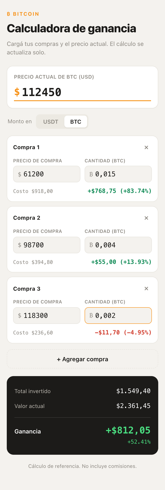

<div align="center">

# ₿ Profit Calculator

**See how much your Bitcoin purchases are up (or down) at today's price.**

[](https://nico-sanchez.github.io/profit-calculator/)
[](https://github.com/Nico-Sanchez/profit-calculator/actions/workflows/pages/pages-build-deployment)


[](LICENSE)



</div>

## Features

- **Several purchases** — add as many buys as you want, each with its own price and amount.
- **BTC or USDT** — enter each purchase as a BTC amount or as the USDT you spent; the app derives the other side.
- **Per-purchase P&L** — gain or loss in USD and percent for every row, coloured green or red.
- **Totals** — total invested, current value and overall gain with its percentage.
- **Live recalculation** — everything updates as you type; there is no submit button.
- **Private by design** — a single static page with no network calls, no storage and no tracking.

## Usage

Open the [live demo](https://nico-sanchez.github.io/profit-calculator/), type the current BTC price and fill in your purchases.

Numbers accept both `.` and `,`. The **last** separator in a number is read as the decimal point, so `112450`, `112,450.00` and `112.450,00` are all 112 450, while `61.200` is 61.2.

The result is a reference figure: it does not include exchange fees or taxes.

## Run locally

It is a single `index.html` with inline CSS and JS. Open it directly or serve the folder:

```bash
python3 -m http.server 8000
```

Then browse to <http://localhost:8000>.

## License

[MIT](LICENSE) © Nicolás Sanchez
